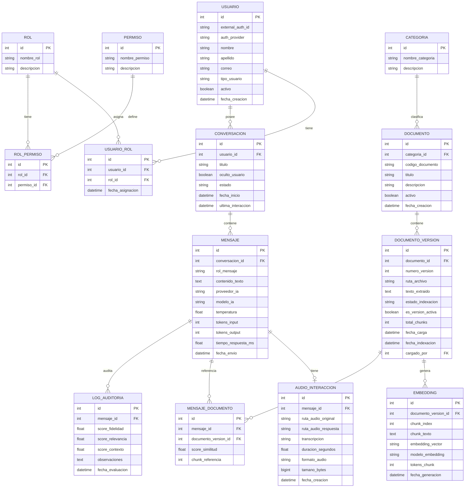

# DER v2 – Sistema de Asistente Académico Inteligente

## Descripción general

El presente Diagrama Entidad-Relación (DER) modela la arquitectura de persistencia del sistema de asistencia académica inteligente basado en IA generativa, procesamiento de voz y arquitectura RAG (Retrieval-Augmented Generation).

El modelo contempla:

- autenticación delegada
- procesamiento conversacional
- historial permanente
- integración multimodal por voz
- auditoría IA
- gestión documental institucional
- embeddings vectoriales
- trazabilidad de respuestas generadas

---

# 1. Módulo de autenticación y autorización

## Objetivo

Gestionar acceso administrativo y contexto institucional de usuarios.

El sistema utiliza autenticación delegada para estudiantes y control RBAC para administradores.

---

## Entidades involucradas

- USUARIO
- ROL
- USUARIO_ROL
- PERMISO
- ROL_PERMISO

---

## Relaciones

- Un usuario puede tener múltiples roles
- Un rol puede pertenecer a múltiples usuarios
- Un rol puede poseer múltiples permisos

---

# 2. Módulo conversacional

## Objetivo

Gestionar consultas realizadas por estudiantes y respuestas generadas por IA.

Cada conversación pertenece a un único usuario.

Las conversaciones son aisladas y persistentes.

---

## Entidades involucradas

- CONVERSACION
- MENSAJE
- AUDIO_INTERACCION

---

## Relaciones

- Un usuario posee múltiples conversaciones
- Una conversación contiene múltiples mensajes
- Un mensaje puede tener una interacción de audio asociada

---

# 3. Módulo de voz

## Objetivo

Permitir procesamiento multimodal mediante audio.

El sistema conserva:

- audio original del estudiante
- transcripción
- audio sintetizado de respuesta

---

## Entidad AUDIO_INTERACCION

Contiene:

- archivo de audio original
- archivo de respuesta sintetizada
- transcripción
- duración
- formato
- tamaño del archivo

---

# 4. Módulo documental y RAG

## Objetivo

Gestionar reglamentos institucionales y recuperación contextual mediante embeddings.

El sistema utiliza arquitectura RAG desde el inicio.

---

## Entidades involucradas

- CATEGORIA
- DOCUMENTO
- DOCUMENTO_VERSION
- EMBEDDING
- MENSAJE_DOCUMENTO

---

## Características principales

### Versionado documental

Cada documento puede poseer múltiples versiones.

Esto permite:

- conservar historial
- reindexar embeddings
- mantener trazabilidad

---

### Embeddings

Cada versión documental genera múltiples chunks vectoriales utilizados para recuperación semántica.

---

### Trazabilidad RAG

La tabla MENSAJE_DOCUMENTO registra qué documentos participaron en la generación de una respuesta.

---

# 5. Módulo de auditoría

## Objetivo

Evaluar calidad y precisión de respuestas generadas por IA.

---

## Entidad LOG_AUDITORIA

Permite almacenar:

- score fidelidad
- relevancia
- calidad contextual
- observaciones administrativas

---

# 6. Descripción de entidades

---

# USUARIO

Representa usuarios institucionales y estudiantes.

## Campos principales

| Campo | Descripción |
|---|---|
| external_auth_id | Identificador externo institucional |
| auth_provider | Sistema proveedor autenticación |
| tipo_usuario | ADMIN / SECRETARIA / ESTUDIANTE |

---

# ROL

Representa roles administrativos del sistema.

Ejemplos:

- ADMIN
- SECRETARIA

---

# PERMISO

Define capacidades específicas del sistema.

Ejemplos:

- CARGAR_DOCUMENTOS
- VER_AUDITORIA
- REINDEXAR_RAG

---

# CONVERSACION

Representa una interacción conversacional perteneciente a un estudiante.

## Características

- historial permanente
- ocultamiento visual
- aislamiento por usuario

---

# MENSAJE

Representa mensajes enviados por usuario o IA.

## Campos importantes

| Campo | Descripción |
|---|---|
| rol_mensaje | USER / ASSISTANT / SYSTEM |
| proveedor_ia | OpenRouter |
| modelo_ia | Modelo utilizado |
| tokens_input | Tokens entrada |
| tokens_output | Tokens salida |

---

# AUDIO_INTERACCION

Representa interacción multimodal asociada a un mensaje.

## Características

- persistencia de audio
- transcripción
- metadata de grabación

---

# LOG_AUDITORIA

Registra evaluación de calidad de respuestas IA.

---

# CATEGORIA

Clasifica reglamentos institucionales.

Ejemplos:

- Becas
- Inscripciones
- Exámenes
- Reglamentos generales

---

# DOCUMENTO

Representa documento institucional principal.

---

# DOCUMENTO_VERSION

Representa versiones individuales del documento.

## Características

- versionado
- indexación
- control estado embeddings

---

# EMBEDDING

Representa fragmentos vectoriales utilizados por RAG.

## Características

- chunk semántico
- vector embedding
- modelo embedding utilizado

---

# MENSAJE_DOCUMENTO

Tabla de trazabilidad RAG.

Permite conocer:

- qué documentos fueron utilizados
- score de similitud
- chunk relevante

---

# 7. Decisiones arquitectónicas reflejadas en el DER

| Decisión | Implementación |
|---|---|
| Auth delegada | external_auth_id |
| RAG desde inicio | EMBEDDING |
| Versionado documental | DOCUMENTO_VERSION |
| Voz obligatoria | AUDIO_INTERACCION |
| Historial permanente | CONVERSACION |
| OpenRouter | proveedor_ia |
| Auditoría IA | LOG_AUDITORIA |
| Consultas aisladas | conversación simple |
| Futuro WebRTC | modularidad voz |

---

# 8. Ventajas del modelo

## Escalabilidad

Permite:

- múltiples modelos IA
- múltiples documentos
- múltiples versiones
- futuras integraciones

---

## Trazabilidad

Permite auditar:

- respuestas
- documentos utilizados
- calidad IA
- historial completo

---

## Modularidad

Los módulos:

- voz
- RAG
- auditoría
- documentos
- conversación

permanecen desacoplados.

---

# 9. Preparación para evolución futura

El modelo permite futuras extensiones como:

- WebRTC tiempo real
- streaming voz
- citación automática
- memoria conversacional avanzada
- analytics IA
- multiuniversidad

---

# 10. DER v2 completo

